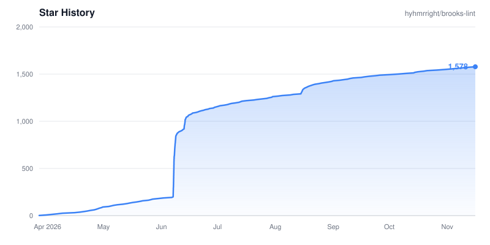

<p align="center"></p>

# brooks-lint

[English](README.md) · **简体中文** · [繁體中文](README.zh-TW.md) · [日本語](README.ja.md) · [한국어](README.ko.md) · [Español](README.es.md)


六个工作流，覆盖代码审查、架构、技术债、测试质量、健康看板与限定范围的修复，以十二本经典软件工程书籍为基础。

**源码状态：** 已确定下一版本为 `2.0.0`，当前源码正在准备该版本，尚未发布到 GitHub 或 npm。发布须等待 npm 权限及全部发布检查确认。GitHub/npm 最近的已发布版本仍为 **1.9.1**。本文描述 **main**，其中部分功能尚未包含在 1.9.1；徽章表示源码版本，不表示已发布。

[从 1.9.1 迁移到 2.0.0](docs/migration-v2.md)
brooks-lint 由 Agent Skills、共享指导和小型确定性报告工具组成。诊断由你的编码代理执行；项目提供工作流、风险分类和报告约定。它不是静态分析器，也不保证模型能发现所有缺陷。

## 从 Codex 开始

```bash
# Source checkout: Git + Bash
git clone https://github.com/hyhmrright/brooks-lint.git
cd brooks-lint
bash scripts/install.sh codex
```

```text
$brooks-review Review the current diff and identify supported maintainability risks.
$brooks-health Assess this repository; distinguish missing evidence from clean dimensions.
```

以上命令将当前源码安装到 Codex 的全局技能目录。如果没有发现技能，请启动新会话。项目级安装应在目标项目中通过绝对路径执行安装脚本，并使用 `codex --project`。保留 `_shared` 与六个技能目录的同级关系。详见 [Codex 指南](docs/codex-setup.md)。

安装**已发布的 1.9.1** 可使用 Node.js 20+：`npx brooks-lint@1.9.1 install codex`。它安装旧版，不包含 main 的全部新功能。更多平台与自定义目录见[入门指南](docs/getting-started.md)。

## 选择符合任务范围的技能

| 技能 | 适用任务 | 是否修改文件？ |
|---|---|---|
| `$brooks-review` | 审查 diff 或指定代码：契约、证据支持的风险及区分性见证。 | 否 |
| `$brooks-audit` | 模块依赖、职责归属和边界完整性；另有团队入门指南。 | 否 |
| `$brooks-debt` | 识别维护债务、排序并制定偿还计划。 | 否 |
| `$brooks-test` | 审查已有测试：断言能检测和遗漏哪些失败。 | 否 |
| `$brooks-health` | 四个维度的简要评估和有证据范围限制的看板。 | 否 |
| `$brooks-sweep` | 在限定范围内诊断并执行已授权、可验证的修复。 | 是 |

Codex 使用 `$brooks-review`；其他宿主使用自己的调用方式。自然语言触发取决于宿主和模型。Health 是摘要，不是四次穷尽式审计。Sweep 需要编辑和验证能力，并沿用已有授权；不会仅因修改多个文件就再次要求确认。

## 如何理解报告

保留的问题应遵循 **现象 → 来源 → 后果 → 修复**：可观察证据、相关工程原则、影响和适当范围内的建议。书籍引用解释框架，不是诊断正确或章节对应准确的证明。受保护行为与未决义务应如实说明，不凭空扣分；预测结果必须与实际运行的检查区分。

分数是按配置汇总已保留问题的结果，**不是代码正确的概率**。Health 从同一份清单计算代码质量、架构、技术债和测试质量。允许执行工具时，随附 Node 工具生成分数并定稿。必要维度缺少决定性证据时标为 **unassessed**，不输出数值综合分。仅无 diff 的 PR 维度可以 **skipped** 并重新分配权重。已评估且未发现问题不等于未知。

交付工具检查提供的输出字节是否与定稿和凭据一致，不验证诊断正确性、后续界面渲染或传输。无法执行工具时必须说明验证限制，不得虚构凭据。详见[评分清单与工具约定](skills/brooks-health/score-ledger.md)。

Sweep 默认最多 **三轮修复总计**，包括首轮及仅处理 Critical 的轮次；同时遵守用户的时间和工具预算。停止时报告有证据支持的原因与未解决项。局部范围已干净，可以与更广维度仍未知同时成立。详见 [Sweep 指南](skills/brooks-sweep/sweep-guide.md)。

## 风险分类

| 生产代码 | 测试 |
|---|---|
| R1 — 认知过载 | T1 — 测试晦涩 |
| R2 — 变更传播 | T2 — 测试脆弱 |
| R3 — 知识重复 | T3 — 测试重复 |
| R4 — 意外复杂性 | T4 — Mock 滥用 |
| R5 — 依赖失序 | T5 — 覆盖幻觉 |
| R6 — 领域模型失真 | T6 — 架构失配 |

## 十二本书

| Book | Author |
|---|---|
| *The Mythical Man-Month* | Frederick P. Brooks Jr. |
| *Code Complete* | Steve McConnell |
| *Refactoring* | Martin Fowler |
| *Clean Architecture* | Robert C. Martin |
| *The Pragmatic Programmer* | Andrew Hunt & David Thomas |
| *Domain-Driven Design* | Eric Evans |
| *A Philosophy of Software Design* | John Ousterhout |
| *Software Engineering at Google* | Titus Winters, Tom Manshreck & Hyrum Wright |
| *The Art of Unit Testing* | Roy Osherove |
| *How Google Tests Software* | James Whittaker, Jason Arbon & Jeff Carollo |
| *Working Effectively with Legacy Code* | Michael Feathers |
| *xUnit Test Patterns* | Gerard Meszaros |

[来源映射](skills/_shared/source-coverage.md)记录概念、权衡和误报保护。这套风险分类是项目对书中思想的综合，不是这些作者共同制定的官方分类。

<a id="benchmark"></a>

## 评测能说明什么

以下三类证据不能混为一谈：

- **离线产品检查:** 安装、算分、交付、解析器约定和案例结构；不证明模型诊断质量。
- **解析器保真度:** 30 份冻结报告的严重度计数、风险代码与 SARIF；验证解析器，不判断发现是否真实。
- **行为对照:** 指定提示和模型下的 Codex 回答，按案例标准评判；结论受案例、执行通道和评审限制。

最新一轮**静态指令对照**经离线复核后：review 和 audit 的通用清单组、技能组均为 **6/6**；test 为 **5/6 对 6/6**。优势只有一个配对案例，案例由同一开发流程编写并复用，不能证明普遍优越。评分在运行后做过修正，也未测量原生技能发现能力或所有模型。

[完整记录与复核](https://github.com/hyhmrright/brooks-lint/tree/17bd333/docs/research/focused-skill-recovery/results/2026-11-16-live/adjudication/README.md) · [Codex 行为评测设计](docs/codex-behavior-evals.md)。历史研究保留在研究分支，产品仓库只携带精简回归样例。

模型为 `gpt-6.1-terra / low`，每个案例每组回答一次。通过要求五个主要行为维度全部通过、没有漏掉预期问题、没有已确认的虚假声明；这些计数不是普遍正确率估计。

[全部六个技能的证据与限制](docs/benchmark-evidence.md)

<a id="installation"></a>

## 安装与兼容性

维护者目前验证 **Codex**。其他集成继续保留，但以往的宿主验证属于历史记录；安装目录测试不代表完整运行兼容性。欢迎附带宿主版本和复现步骤的社区报告。安装器支持 13 个具名目标和通用 `agents` 目录。

`<platform> = opencode · cursor · windsurf · antigravity · pi · kiro · copilot · droid · dsh · gemini · codex · claude · bob · agents`

[Codex](docs/codex-setup.md) · [OpenCode](docs/opencode-setup.md) · [Cursor](docs/cursor-setup.md) · [Windsurf](docs/windsurf-setup.md) · [Antigravity](docs/antigravity-setup.md) · [pi](docs/pi-setup.md) · [GitHub Copilot](docs/copilot-setup.md) · [Kiro](docs/kiro-setup.md) · [Factory Droid](docs/factory-droid-setup.md) · [DeepSeek Harness](docs/dsh-setup.md) · [IBM Bob](docs/bob-setup.md)

保留的 Claude Code 市场命令如下；此路径目前未经维护者持续验证：

```text
/plugin marketplace add hyhmrright/brooks-lint
/plugin install brooks-lint@brooks-lint-marketplace
```

## 配置

```yaml
version: 1
strictness: balanced
ignore:
  - "**/vendor/**"
sweep:
  max_iterations: 3
# Optional: deliberately omit a risk from this review.
# disable:
#   - T5
```

从 [`.brooks-lint.example.yaml`](.brooks-lint.example.yaml) 开始。共享约定定义严格度、严重度覆盖、忽略路径、`focus`/`disable`、自定义 `Cx` 风险和范围化抑制。禁用 T5 会主动省略其诊断；T5 不只是覆盖率百分比检查。详见[配置与报告约定](skills/_shared/common.md)。

## CI 是另一条执行路径

现有 GitHub Action 使用 **Anthropic 兼容 API**，不使用 Codex 登录额度。它只审查收集的 diff，没有交互式仓库工具或修复能力；该历史提供方路径不属于当前维护者的实时验证范围。下面是未来发布的源码版本模板；**2.0.0 标签发布前不能直接运行**。若使用已发布版本，请改为 `v1.9.1` 并遵循其对应功能说明。

```yaml
# Source-version template only: the 2.0.0 tag is not published yet.
- uses: hyhmrright/brooks-lint/.github/actions/brooks-lint@v2.0.0
  with:
    mode: review
    anthropic-api-key: ${{ secrets.ANTHROPIC_API_KEY }}
```

[执行器约定](docs/runner-contracts.md)与[完整工作流模板](docs/github-action-example.yml)说明基础分支配置、fork 限制、无效报告及权限。费用取决于提供方、模型和输入，不承诺固定单次价格。

## 开发与贡献

离线验证命令：

```bash
npm run validate
npm test
npm run evals
npm run benchmark
npm run evals:codex:validate
```

实时 Codex 评测必须明确选择模型和预算；日常离线检查不要运行历史 Anthropic 评测。参见[贡献指南](CONTRIBUTING.md)、[变更记录](CHANGELOG.md)及[历史示例](docs/gallery.md)。感谢贡献者，包括在 [#44](https://github.com/hyhmrright/brooks-lint/pull/44) 提供原生 DSH 集成的 [@Sad-happy](https://github.com/Sad-happy)。

MIT — [许可证](LICENSE)。

[](https://github.com/hyhmrright/brooks-lint/stargazers)
