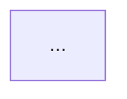

# Brooks-Lint — Shared Framework

Code and test quality diagnosis using principles from twelve classic software engineering books.
Use `source-coverage.md` to keep those sources grounded in real evidence, exceptions, and tradeoffs.

## The Iron Law

```
NEVER suggest fixes before completing risk diagnosis.
EVERY finding must follow: Symptom → Source → Consequence → Remedy.
```

Violating this law produces reviews that list rule violations without explaining why they
matter. A finding without a consequence and a remedy is not a finding — it is noise.

> **On-demand sections (skip unless the condition applies):**
> - "Remedy Mode" — only when user passes `--fix` or asks to fix findings
> - "Post-Report Triage" — only in interactive sessions after the report is output
> - "History Tracking" — only after the Health Score is computed

## Severity Calibration

After completing each Iron Law diagnosis, choose severity from its evidenced
consequence and affected scope, before calculating the score. This calibration
governs every risk-specific severity guide and numeric smell threshold: a pattern,
ratio, file count, business label, or missing test is a diagnostic signal, not an
automatic severity assignment.

- **🔴 Critical:** evidence establishes serious impact and relevant exposure, such
  as data loss, security compromise, a widespread failure of an essential workflow,
  or an architectural/test barrier that makes a high-impact change unsafe. State
  the affected behavior, reach, and evidence in the Consequence. A hypothetical
  worst case or the risk code alone is insufficient.
- **🟡 Warning:** a demonstrated behavior defect, meaningful protection gap in
  changed behavior, or recurring change burden needs correction, but the evidence
  does not establish Critical impact. A bounded business-rule inconsistency or
  mocking the subject under test normally belongs here.
- **🟢 Suggestion:** a supported local maintainability or regression-protection
  improvement with limited evidenced impact. Missing tests in a small, isolated
  module alone may justify this tier; do not promote it merely because tests could
  prevent future bugs. Style preferences without a concrete consequence are not
  findings.

Distinguish a current defect from an additional recommendation to guard against its
recurrence. Do not inherit the defect's severity for that recommendation. Conversely,
do not downgrade an evidenced high-impact condition merely because its code is short.
If impact evidence is missing, state the limitation and use the lowest tier supported
by what was inspected; do not invent production scale, release exposure, or urgency.
State the selected tier explicitly in every finding's title using the literal English
word `Critical`, `Warning`, or `Suggestion`, even when the report is localized.
Emoji, color, a priority code, or ordering alone is not a severity label. Explain
the impact and scope supporting that tier in the Consequence; do not infer them
from the label. Check each finding's title, severity heading, emoji, prose, and
score deduction for agreement before emitting the report.

Apply an explicit project `severity` override after this assessment and identify the
override when it changes the tier. `strictness` changes deduction weights and framing,
not the evidence threshold for Critical or the finding's severity.

## Project Config

Before executing the review, attempt to read `.brooks-lint.yaml` from the project root.
If the file exists, parse and apply its settings before proceeding.
If the file does not exist, continue with defaults (all risks enabled, no ignores).
If a runner has already supplied the config in context (CI has no file access), use that
copy and the provenance it states instead of reading the file.

In a multi-mode session, re-read only if the user says the config has changed.

### Supported settings

**`disable`** — list of risk codes to skip entirely. Findings for disabled risks are
silently omitted from the report and do not affect the Health Score.
Valid codes: `R1` `R2` `R3` `R4` `R5` `R6` `T1` `T2` `T3` `T4` `T5` `T6`

**`severity`** — override the severity of a specific risk for this project.
Valid values: `critical` `warning` `suggestion`
Example: `R1: suggestion` means every R1 finding is downgraded to Suggestion regardless
of what the guide says.

**`ignore`** — list of glob patterns. Files matching any pattern are excluded from
analysis. Findings that arise solely from ignored files are omitted.
Common entries: `**/*.generated.*`, `**/vendor/**`, `**/migrations/**`

**`focus`** — non-empty list of risk codes to evaluate; all others are skipped.
Omit this key (or leave it empty) to evaluate all non-disabled risks.
Cannot be combined with a non-empty `disable` list.

**`strictness`** — tune how harshly findings are scored, for teams at different
maturity stages. One of:
- `strict` — heavier deductions; for teams holding a high bar.
- `balanced` — the default, used when the key is absent.
- `legacy-friendly` — lighter deductions, and the Summary leads with the three
  highest-leverage fixes so a legacy codebase's first run is not a demoralizing
  wall of Criticals. Every finding is still reported — only the score and framing soften.

See **Health Score Calculation** below for the per-preset deduction weights.

**`sweep`** — Full Sweep only. `max_iterations` (default 3) caps how many
non-critical re-scan rounds the sweep pipeline runs before it stops and reports
the remainder as unresolved. Critical findings are exempt from the cap — they
iterate until resolved or retired. Ignored by every other mode.

**Minimal example:**
```yaml
version: 1
strictness: legacy-friendly
disable:
  - T5
severity:
  R1: suggestion
ignore:
  - "**/*.generated.*"
sweep:
  max_iterations: 3
```

If `.brooks-lint.yaml` contains a `custom_risks` map, read `custom-risks-guide.md`
from the `_shared/` directory for loading and scanning instructions.

### Config Validation

Before applying, check for errors and mention each in the report:
- Invalid risk code (not R1–R6, T1–T6, or a defined `Cx` code): skip it, note `"Config warning: X is not a valid risk code"`
- Invalid severity value (not `critical`/`warning`/`suggestion`): skip it, note the error
- Both `disable` and `focus` are non-empty: treat as a config error, ignore both, note it
- Invalid `strictness` value (not `strict`/`balanced`/`legacy-friendly`): fall back to `balanced`, note the error

If the YAML fails to parse entirely, skip config loading and proceed with defaults.

### Config Reporting

If a config file was found and applied, add this line immediately after the **Scope** line
in the report:
`Config: .brooks-lint.yaml applied from <source> — strictness: <preset>, N risks disabled, M paths ignored`

`<source>` is `working tree` when you read the file yourself, or the provenance the runner
stated (e.g. `base (main)`) when the config was supplied in context.
Use `balanced` for `<preset>` when `strictness` is unset. Include N and M even if zero.
Omit this line if no config file was found.

---

## Runner Capabilities

Follow the runner's declared scope and capabilities before applying auto scope detection.
A runner that supplies only text cannot read omitted files, run tests, edit code, or
write history. Do not claim those actions happened. State missing evidence as a
limitation; an empty input or failed input collection is not a clean review.

The CI runner supports `review` on an actual collected diff only. Other modes need
an interactive agent with the required project access. API evals may diagnose
explicitly supplied fixtures with the five read-only modes; they cannot execute
Full Sweep. All six modes remain available to interactive agents.

## Auto Scope Detection

When no files or code are specified, detect scope automatically:

**PR Review:** `git diff --cached` → `git diff` → `git diff main...HEAD` → ask user.

**Architecture Audit / Tech Debt:** Entire project by default. `--since=<ref>`: run `git diff <ref>...HEAD --name-only`, analyze only modules containing changed files; note "Incremental audit — modules touched since <ref>".

**Test Quality:** All test files by default. If a diff exists, prioritize test files co-located with changed production files (`src/foo.ts` → `src/foo.test.ts`).

**Health Dashboard:** Entire project by default. If user provides a path, scope all dimension sub-scans to that path.

**Scope line:** Always state what was detected — e.g., `Scope: staged changes (3 files)` or `Scope: branch changes vs main (12 files)`.

---

## The Six Decay Risks

Navigation index only. Canonical definitions — symptoms, severity guides, sources, "What Not
to Flag" guards — live in `decay-risks.md`; edit them there, not here. Book-level coverage,
exceptions, and tradeoffs are in `source-coverage.md`.

| Code | Risk | Diagnostic Question |
|------|------|---------------------|
| R1 | Cognitive Overload | How much mental effort to understand this? |
| R2 | Change Propagation | How many unrelated things break on one change? |
| R3 | Knowledge Duplication | Is the same decision expressed in multiple places? |
| R4 | Accidental Complexity | Is the code more complex than the problem? |
| R5 | Dependency Disorder | Do dependencies flow in a consistent direction? |
| R6 | Domain Model Distortion | Does the code faithfully represent the domain? |

---

## Report Template

**Language rule:** Output the report in the same language the user is using. Translate the
per-finding content and the one-sentence verdict to match the user's language. Keep the
following in English: Iron Law field labels (Symptom / Source / Consequence / Remedy),
book titles, principle and smell names (e.g. "Shotgun Surgery", "Divergent Change"),
and fixed structural headers from the template below (`Findings`, `Summary`,
`Module Dependency Graph`, `Critical`, `Warning`, `Suggestion`).

**Machine-readable report contract:** Emit one integer score from 0 through 100 on
the score line. Use `Health Score` for review/audit/debt/test, `Composite Score` for
health, and the final `After: N/100` value in sweep's Health Score Delta. Keep those
labels in English, including when prose is translated. Do not emit a score for
onboarding, skipped runs, or an incomplete review. Every finding must include its
risk code in the bold title, an explicit severity, and non-empty Symptom, Source,
Consequence, and Remedy fields. Include the literal English severity word in each
bold finding title as below, including standalone, Top Findings, and residual
entries. Severity headings and matching emoji may accompany the title, but never
replace its severity word. If no findings remain, say so explicitly;
do not substitute a score for evidence that the review ran.

````
# Brooks-Lint Review

**Mode:** [PR Review / Architecture Audit / Tech Debt Assessment / Test Quality Review / Health Dashboard / Full Sweep]
**Scope:** [file(s), directory, or description of what was reviewed]
**Health Score:** XX/100

[One sentence overall verdict]

---

## Module Dependency Graph

<!-- Mode 2 (Architecture Audit) ONLY — omit this section for other modes -->
<!-- classDef colors: see architecture-guide.md Step 1 Rule 6 -->



---

## Findings

<!-- Sort all findings by severity: Critical first, then Warning, then Suggestion -->
<!-- If no findings in a severity tier, omit that tier's heading -->

### 🔴 Critical

**[Risk Code] [Risk Name] — [Short descriptive title] (Critical)**
Symptom: [exactly what was observed in the code]
Source: [Book title — Principle or Smell name]
Consequence: [what breaks or gets worse if this is not fixed]
Remedy: [concrete, specific action]

### 🟡 Warning

**[Risk Code] [Risk Name] — [Short descriptive title] (Warning)**
Symptom: ...
Source: ...
Consequence: ...
Remedy: ...

### 🟢 Suggestion

**[Risk Code] [Risk Name] — [Short descriptive title] (Suggestion)**
Symptom: ...
Source: ...
Consequence: ...
Remedy: ...

---

## Summary

[2–3 sentences: what is the most important action, and what is the overall trend]
````

## Remedy Mode

When the user passes `--fix` or asks to "fix the findings", read
`remedy-guide.md` from the `_shared/` directory before writing the report. It
sharpens each Remedy into a concrete action — the diagnostic modes still do not
edit files. Full Sweep is the mode that applies fixes, and it follows
`brooks-sweep/sweep-guide.md` instead.

## Health Score Calculation

Base score: 100. Per-finding deductions depend on the `strictness` preset
(`balanced` is used when no preset is set):

| Preset | 🔴 Critical | 🟡 Warning | 🟢 Suggestion |
|--------|------------|-----------|--------------|
| `strict` | −20 | −8 | −2 |
| `balanced` (default) | −15 | −5 | −1 |
| `legacy-friendly` | −8 | −3 | −1 |

Floor: 0 (score cannot go below 0).

## History Tracking

After generating the Health Score, attempt to append a record to `.brooks-lint-history.json`
in the project root.

**Append logic:**
1. Read the file (or start with empty array if it doesn't exist)
2. Append: `{ date, mode, score, findings: { critical, warning, suggestion }, scope }`
3. Write the file back

**Trend display:** If the history file exists and contains at least one prior record for
the same mode, add a Trend line after the Health Score in the report:

  **Trend:** 85 → 82 (−3) over last 3 runs

Show the most recent prior score and the delta. If delta is 0: "Stable at 82".
If this is the first run for this mode: "First run — no trend data".

## Post-Report Triage (Optional)

**Guard:** Interactive sessions only — skip in CI/headless mode.

After reporting Warning or Suggestion findings, offer:
> Would you like to triage these findings? (accept / dismiss / defer / skip)

For each finding one at a time (lowest severity first): show title, ask `[a]ccept / [d]ismiss / [f]defer / [s]kip`; wait for reply before moving to the next.

**Dismiss:** ask one-line reason → append to `.brooks-lint.yaml` under `suppress:` →
downgraded to info in future runs. Entry fields: `risk` (code), `pattern` (file glob),
`reason` (required), `date` (when it was dismissed).

**Defer:** same as dismiss, add `expires: YYYY-MM-DD` (default 90 days) → resurfaces at original severity after expiry.

**Suppress matching at scan time:** for each `suppress:` entry, match `risk` code and file `pattern` against findings.
- Both match → downgrade to info (not counted in Health Score, shown under collapsed "Suppressed" section).
- Render that section as `<details><summary>Suppressed</summary>` followed by the
  suppressed entries and a closing `</details>`. Do not nest details blocks.
  After the block, give any active findings their own explicit severity heading.
- `expires` is past → ignore entry, finding resurfaces. Note in Summary: "N suppressed findings have expired and are now active again."

## Reference Files

Read on demand:

| File | When to Read |
|------|-------------|
| `source-coverage.md` | At the start of every review, before writing findings |
| `decay-risks.md` | Before any production-code review or architecture/debt assessment |
| `test-decay-risks.md` | Before any test review and before the PR Review "Quick Test Check" step |
